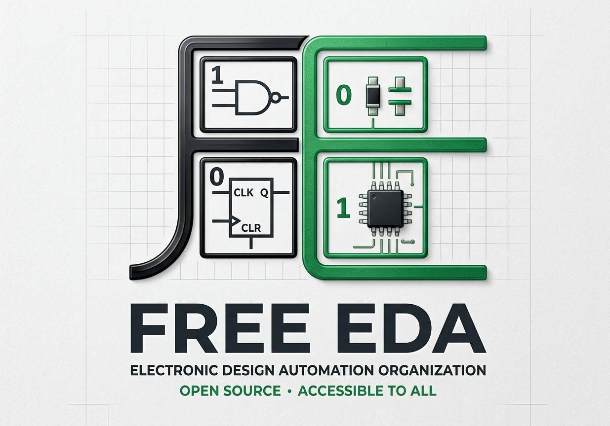

# FreEDA Open-Source FPGA Simulator



FreEDA FPGA Simulator is a desktop project for exploring FPGA design workflows.
It is written in C++17 with Qt and is built with CMake. The current codebase
provides a Qt application shell and a Verilog-oriented tokenizer, with project,
synthesis, netlist, implementation, and schematic workflows represented in the
interface as work in progress.

## Features

### Available in the current codebase

- Qt desktop application for Windows, Linux, and macOS
- CMake build system with Qt 6 support
- Verilog and SystemVerilog keyword recognition
- Tokenization of:
  - identifiers
  - based and sized numbers
  - strings
  - operators and punctuation
  - comments
  - system tasks and functions
- Initial C++ models for modules, gates, registers, wires, and timing
- A basic project window with File and Tools menus

### Planned and in-progress

- New/open project actions
- Verilog source loading and editing
- Module and netlist construction
- Synthesis
- `.v` to netlist compilation
- Implementation and placement/routing
- Schematic and implementation viewers

The menu actions are currently interface placeholders; the application does not
yet expose a complete HDL simulation workflow.

## Requirements

- C++17-compatible compiler
- CMake 3.16 or newer
- Qt 5 or Qt 6 Widgets development package

Qt 6 is the recommended and primary build path in `CMakeLists.txt`.

## Build

### Qt Creator

1. Install Qt Creator and a Qt 5 or Qt 6 Widgets Kit.
2. Open `CMakeLists.txt` as a CMake project.
3. Select a kit and configure the project.
4. Build and run the `FPGASimulator` target.

### Command line

Configure the project from the repository root:

```powershell
cmake -S . -B build -DCMAKE_BUILD_TYPE=Debug
```

If CMake cannot find Qt, provide the Qt installation prefix:

```powershell
cmake -S . -B build -DCMAKE_PREFIX_PATH="C:/Qt/<Qt-Version>/<Kit>"
```

Build and run:

```powershell
cmake --build build
.\build\FPGASimulator.exe
```

The executable location may vary for Qt Creator, Visual Studio generators,
multi-config builds, and non-Windows platforms.

On Linux and macOS, use the executable under the relevant build directory
instead of `FPGASimulator.exe`.

## Using the application

Launch `FPGASimulator` and open the **File** or **Tools** menu to view the
planned project workflow. Project creation, HDL parsing, synthesis,
implementation, and schematic viewing are under active development.

## Project structure

| Path | Purpose |
| --- | --- |
| `main.cpp` | Application entry point |
| `mainwindow.*` | Qt main window and UI definition |
| `mainwindow.ui` | Qt Designer interface |
| `verilog_token.*` | Verilog/SystemVerilog lexical tokenizer |
| `fileparser.*` | Token-to-module parser interface |
| `verilog_module.*` | Verilog module model |
| `wire.*`, `reg.*`, `gates.*` | FPGA data structure models |
| `time.*` | Timing support |
| `CMakeLists.txt` | CMake and Qt build configuration |

## Development status

This repository is an early-stage FPGA simulator prototype. It is suitable for
contributing to the parser, data models, synthesis pipeline, and Qt interface,
but it should not yet be used as a complete synthesis or verification tool.

Contributions are welcome. Before submitting changes:

1. Keep C++ code compatible with C++17.
2. Preserve Qt 5/Qt 6 compatibility where practical.
3. Separate lexical, parsing, model, and GUI concerns.
4. Build the `FPGASimulator` target and verify the Qt application starts.
